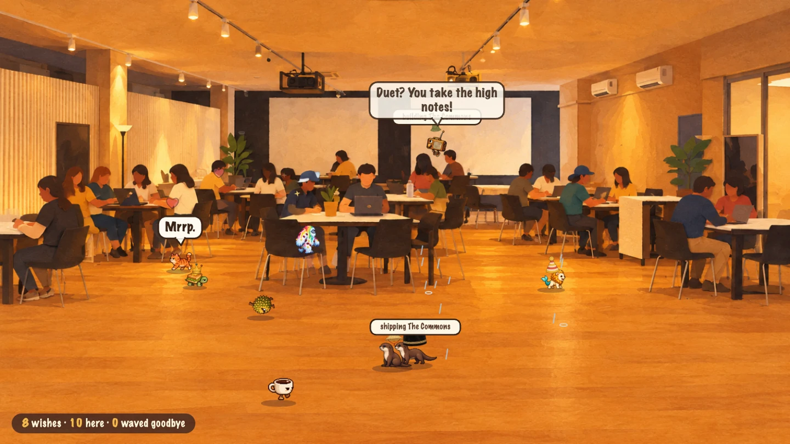
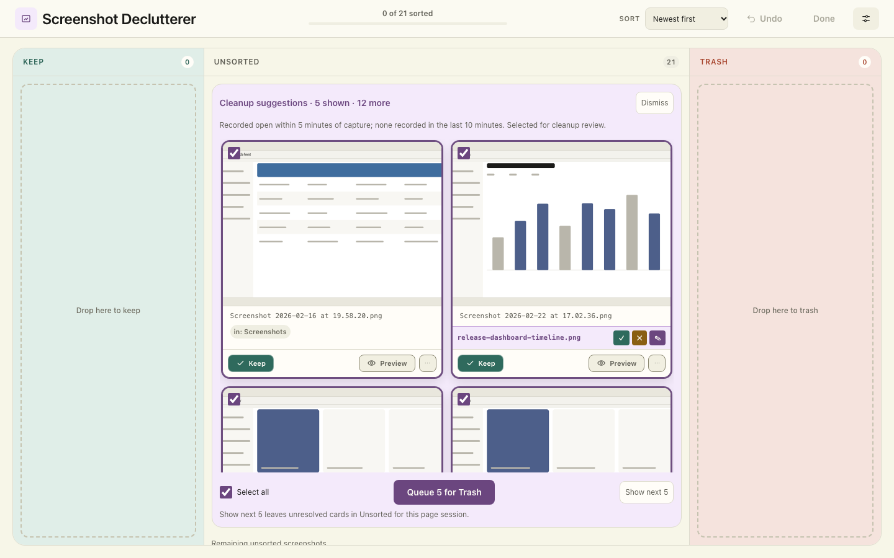
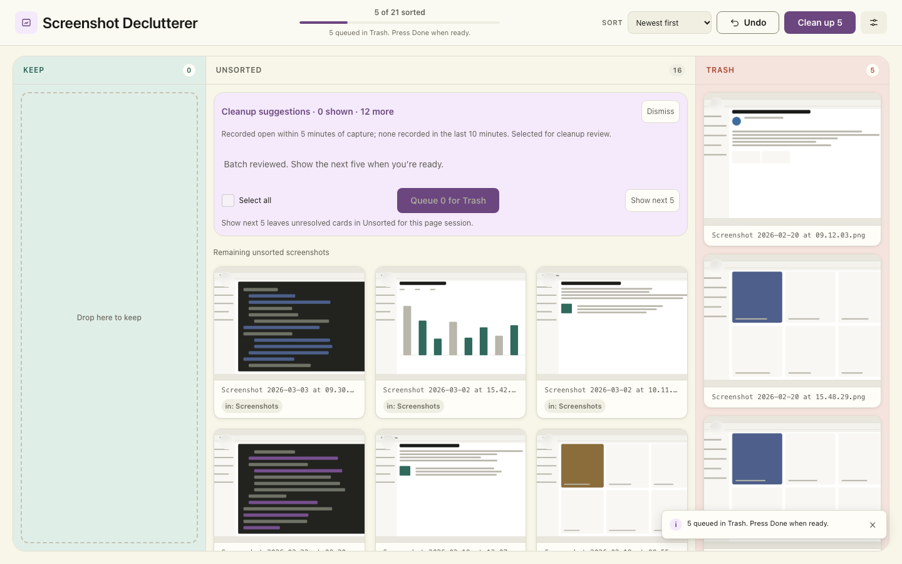
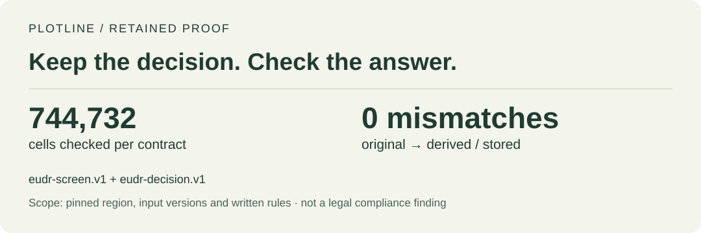
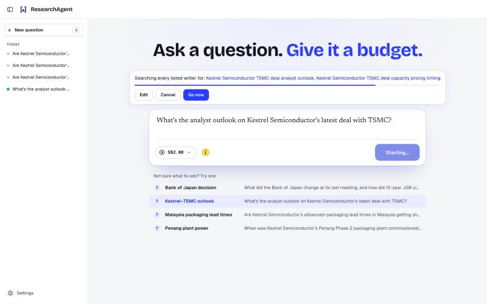
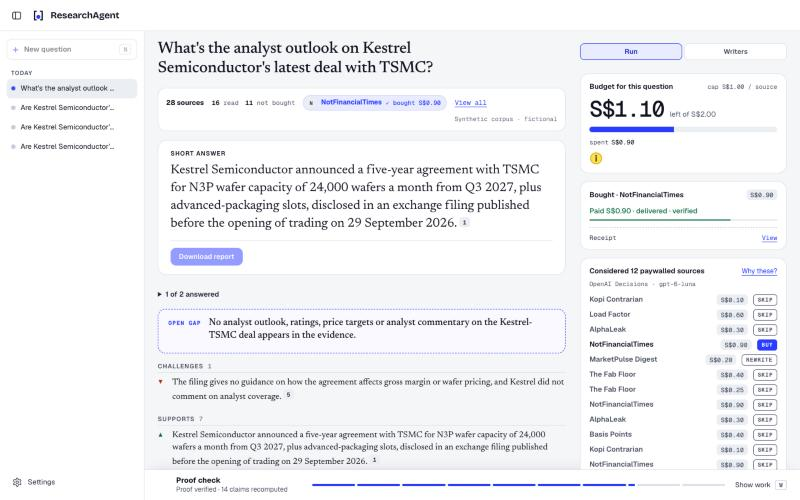
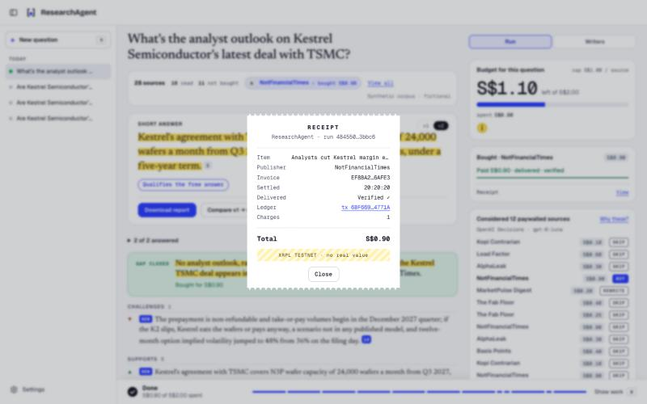
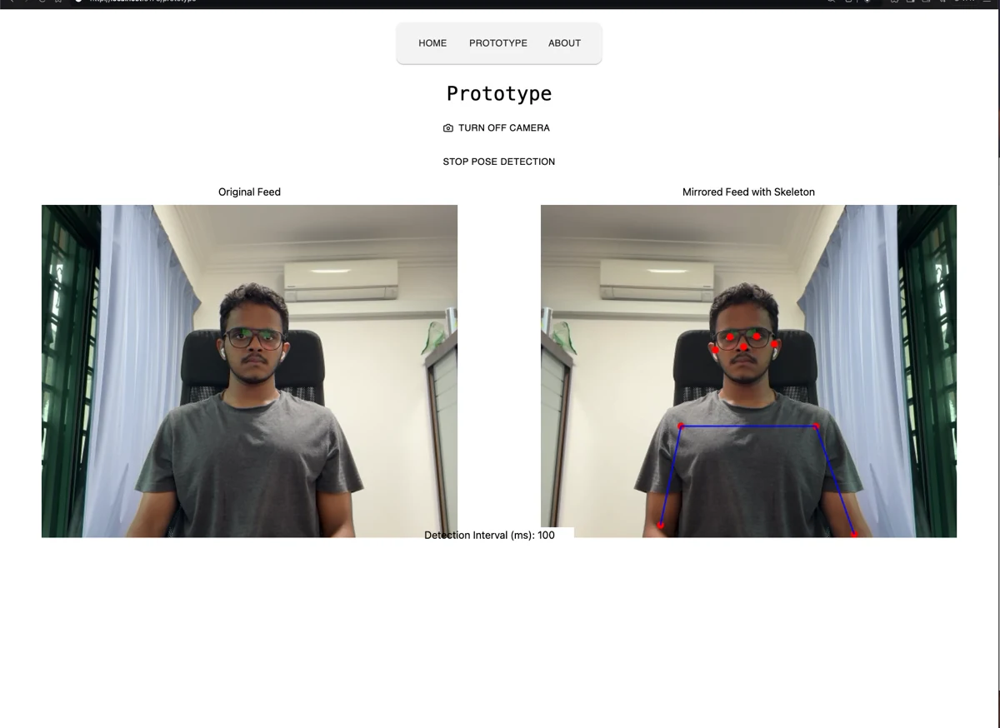
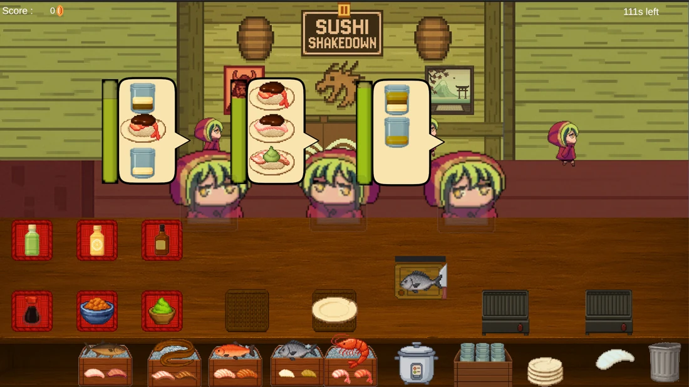
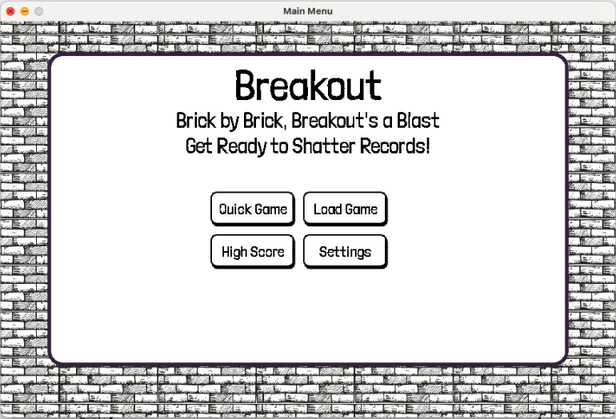

# Hey, I'm Guru.

I build things in Singapore. Some start with a small annoyance on my Mac. Others start in a room full of people, with a deadline and an idea I hadn't planned for.

[My website](https://guruprasathgopal.vercel.app/) · [LinkedIn](https://www.linkedin.com/in/guruprasath3200/) · [Say hello](mailto:guruprasath3200@gmail.com)

Here are a few things I've been making. *Shelf rearranged October 2026.*

## A room that builds itself

At 10:01, the organisers started explaining the makeathon. By 10:04, I'd dropped all ten ideas I'd prepared.

I ended up building **The Commons**: scan a QR code, wish for a creature, and watch it walk into a cartoon of the room you're sitting in. The agent writes its behaviour, tests it, fixes its bugs and draws it. Solo build; **Best Use of Tech** at Common Grounds.

[The build and how it works →](https://github.com/Collaboration95/common-grounds-makeathon)

## My desktop used to be a graveyard of screenshots

Hundreds of little mysteries I had to open one by one. So I made **Screenshot Declutterer**.

**Before:** a batch waiting for review. **After:** five queued for Trash, with Undo still there. These are synthetic demo screenshots; click either to look closer.

 

Keep, rename, compare similar images, change your mind. Nothing goes to macOS Trash until you confirm. Optional naming runs on the Mac too.

[Run it locally →](https://github.com/Collaboration95/screenshot-declutterer)

## How much of a map do you actually need?

**Plotline** keeps what a forest-map screening rule needs, then checks that the smaller representation gives the same answers.

**744,732 cells per contract. Zero mismatches.** A bounded hackathon experiment, with the rule and retained evidence open to inspection.

[Read the experiment](https://github.com/Collaboration95/hr-2026) · [Inspect the proof](https://github.com/Collaboration95/hr-2026/blob/main/artifacts/decision/proof-v1.json)

## An agent bought an article. Now what?

For **ResearchAgent**, our team kept coming back to three questions: is it worth buying, did the right evidence arrive, and can someone follow what happened?

**1. Set a budget → 2. Check the evidence → 3. Keep the receipt.**

  

SingHacks finalist, built with my team. Fictional articles and XRPL Testnet, with challenges and refunds in the demo. The Cloud Run deployment has been retired; the walkthrough is still there.

[Follow the walkthrough →](https://github.com/Collaboration95/theFastandtheFungible#readme)

## Two tabs I keep around

**[yald](https://github.com/Collaboration95/yald)** started because I wanted to know where my coding-agent tokens were going. Now it's a tab that's always open. Read-only local reports; the cost chart estimates API prices, not my subscription bill. Public preview.

Then there's **[talktoit](https://github.com/Collaboration95/talktoit)**, for asking questions of an Apple Health export. The interesting bit turned out to be the importer: one recorded M1 benchmark went from about 26 minutes to 9.77 seconds. [The measurement, without anyone's health records.](https://gist.github.com/Collaboration95/f5f5f7414e04cb5c75e2d2e4274b3bcb)

## Earlier, I was teaching a camera where to look

**Fitback** was our capstone team's two-photo sizing project. The public **DetectT** prototype shows the pose-guidance and capture part; getting two model runtimes to cooperate meant isolating the older runtime in a worker.

Our team took [first place in Design AI at InspireCon 2025](https://www.sutd.edu.sg/media-releases-listing/sutd-students-partner-top-firms-including-loreal-db-schenker-changi-airport-group-in-first-inspirecon-showcase/). [Here's the camera code.](https://github.com/Collaboration95/DetectT)

## A couple of older saves

 

Sushi orders on one side, bouncing bricks on the other. **[Sushi Shakedown](https://github.com/Collaboration95/Sushi-Shakedown)** is a team Unity game ([upstream](https://github.com/jaga991/Sushi-Shakedown)); I worked on backgrounds and NPCs. **[Breakout](https://github.com/Collaboration95/Breakout_C)** is an earlier team course project in C and SDL2. Saves, scores, sound, and a lot of bouncing.

---

There are other threads too: **[Rewind](https://github.com/Collaboration95/rewind-app)**, our group time-capsule prototype; **[FlickPond](https://github.com/Collaboration95/dc2)**, our course team's video pipeline; and **[uno-dos-tres](https://github.com/Collaboration95/uno-dos-tres)**, a phone camera reading Uno cards.

Further along the trail: [provenance-aware permissions with the MandateFlow team](https://github.com/tradaokamsa/MandateFlow), [Handoff's evidence-to-invoice experiment](https://github.com/Collaboration95/handoff), [StyleMind's fashion conversations](https://github.com/Collaboration95/stylemind), [a Raspberry Pi looking for parked cars](https://github.com/Collaboration95/FindMyCar_50.046), and [an educational Raft-style booking simulation](https://github.com/Collaboration95/Movie_Booking_Backend_Chubby-Raft).

Project screenshots, not stock art. <a href="ASSET_SOURCES.md">Image sources and context</a>.
